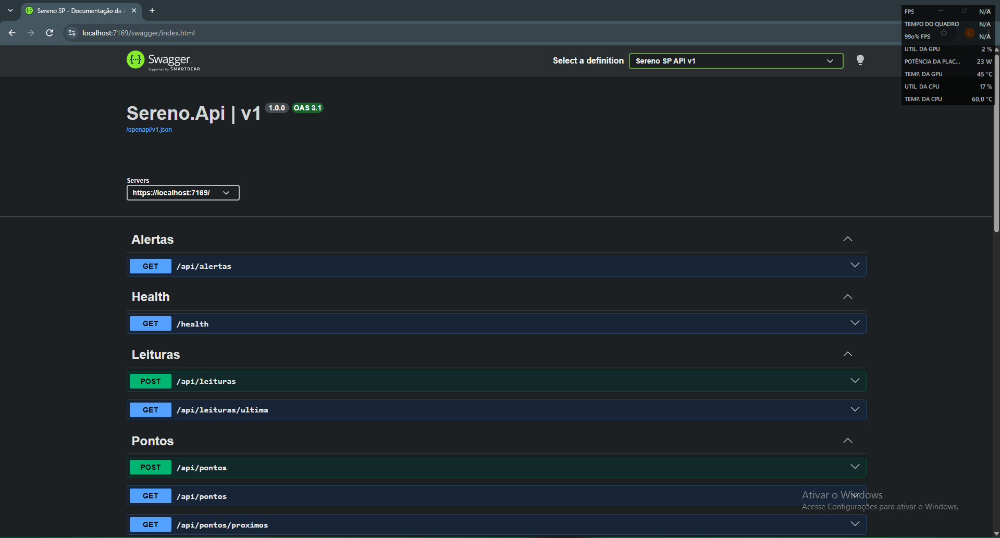
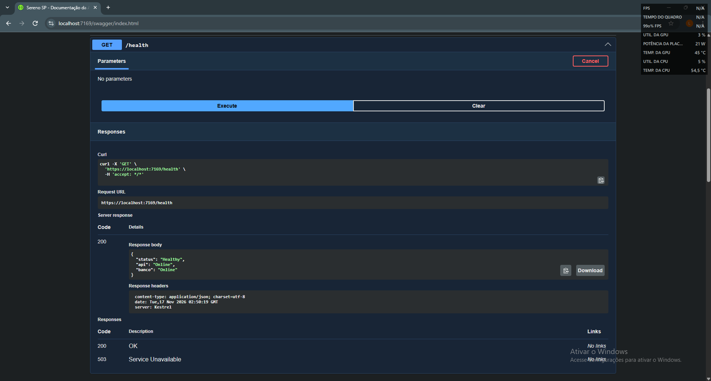
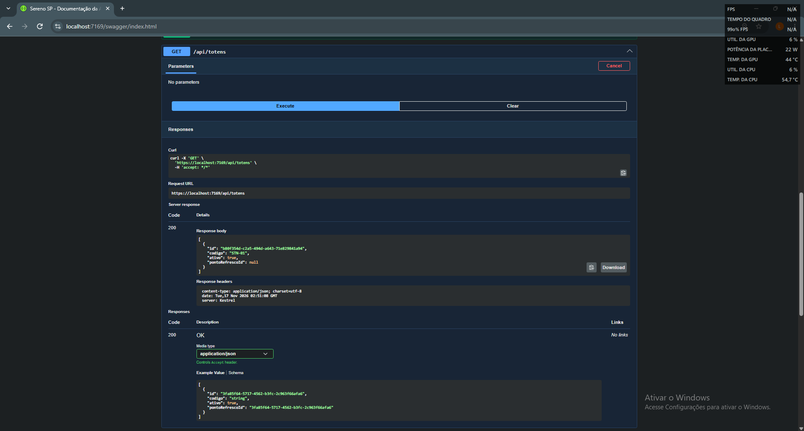
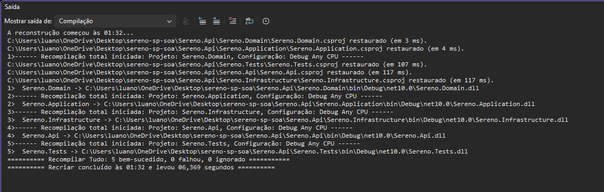
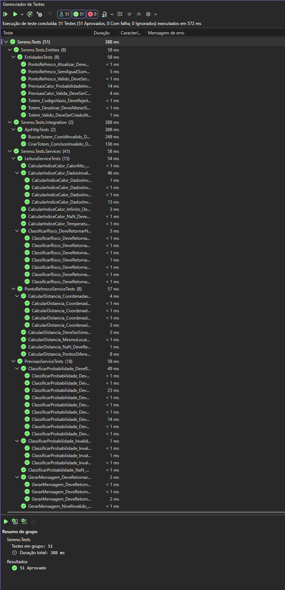
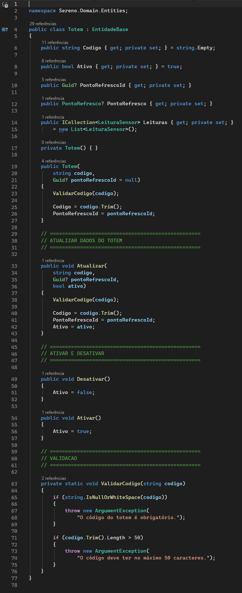
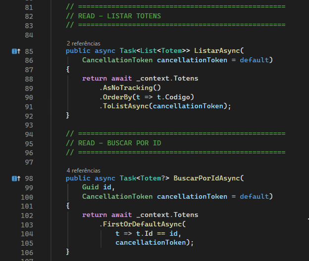
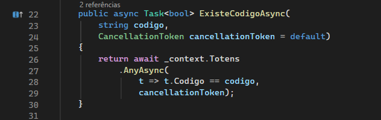
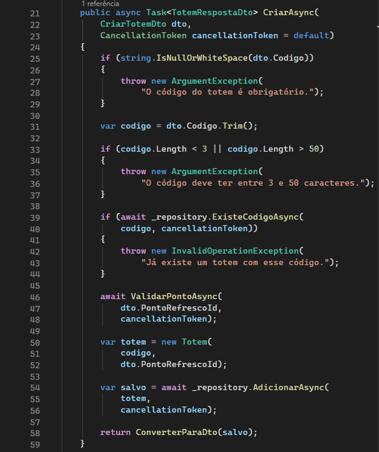

# Sereno SP — C# Software Development

**FIAP · Global Solution CitizenTech 2026.2**  
**Disciplina:** C# Software Development

## Integrantes

| Integrante | RM |
|---|---|
| Luan Orlandelli Ramos | 554747 |
| Arthur Bobadilla Franchi | 555056 |
| Jorge Luiz Silva Santos | 554418 |

## O problema

Em São Paulo, o calor urbano intenso afeta o deslocamento, o trabalho ao ar livre e o uso dos espaços públicos. A exposição prolongada pode ser especialmente preocupante para pessoas idosas e trabalhadores que passam horas sob o sol. Embora existam previsões meteorológicas gerais, elas nem sempre ajudam o cidadão a identificar o risco no local onde está, acompanhar a mudança das condições ambientais ou encontrar opções próximas para reduzir a exposição ao calor.

O **Sereno SP** foi concebido para aproximar a informação ambiental das decisões cotidianas. O recorte inicial considera a região de Santana, na zona norte da capital, combinando medições locais, classificação do risco térmico e localização de pontos de refresco.

## A solução

O **Sereno SP** é uma CitizenTech que organiza informações sobre calor urbano e as disponibiliza por meio de uma **Web API REST em C#/.NET**. O backend permite cadastrar totens de monitoramento, receber leituras de temperatura e umidade, calcular o índice de calor, classificar riscos, registrar alertas, consultar previsões de calor e localizar pontos de refresco.

Uma aplicação cliente pode, por exemplo, consultar a última leitura de um totem, apresentar o nível de risco ao usuário e indicar locais cadastrados com água ou sombra. Os dados são persistidos em PostgreSQL, permitindo que diferentes aplicações consumam os mesmos recursos por endpoints HTTP documentados.

Nesta implementação, o foco de C# Software Development é a aplicação de **Programação Orientada a Objetos, interfaces, injeção de dependência, ASP.NET Core Web API, Entity Framework Core, LINQ, programação assíncrona e testes automatizados** em um projeto funcional e organizado.

## Tecnologias

- **C# e .NET 10**
- **ASP.NET Core Web API** com controllers REST
- **Entity Framework Core** e provedor **Npgsql**
- **PostgreSQL**
- **LINQ** para consultas e ordenações
- **OpenAPI / Swagger UI**
- **xUnit** para testes automatizados

## Arquitetura do projeto

```text
Sereno.Api.slnx
Sereno.Api/              API REST, controllers, Program.cs e Swagger
Sereno.Application/      Casos de uso, serviços, DTOs e interfaces
Sereno.Domain/           Entidades, enumerações e validações de domínio
Sereno.Infrastructure/   DbContext, repositórios EF Core e migrações
Sereno.Tests/            Testes automatizados xUnit e HTTP

evidencias/csharp/       Capturas de execução e implementação
sereno-migrations.sql    Script SQL complementar das migrações
```

### Programação Orientada a Objetos — 3,0 pontos

O domínio representa os conceitos da solução com classes como `Totem`, `LeituraSensor`, `PontoRefresco`, `Alerta` e `PrevisaoCalor`. As entidades encapsulam o próprio estado e implementam validações e métodos de negócio. Por exemplo, `Totem` valida seu código e oferece os métodos `Atualizar`, `Ativar` e `Desativar`; `LeituraSensor` verifica faixas válidas de temperatura e umidade.

A classe `EntidadeBase` centraliza propriedades comuns. A aplicação usa interfaces como `ITotemRepository` para desacoplar os serviços da implementação de persistência. A injeção de dependência é configurada no `Program.cs`.

### Web API REST — 2,5 pontos

Os controllers da camada `Sereno.Api` expõem recursos HTTP e retornam códigos adequados às operações, como `200 OK`, `201 Created`, `204 No Content`, `400 Bad Request`, `404 Not Found` e `409 Conflict`. DTOs definem os dados recebidos e devolvidos, evitando expor diretamente as entidades persistidas.

### Entity Framework Core e LINQ — 1,5 ponto

O `SerenoDbContext` representa as tabelas e os relacionamentos entre entidades no PostgreSQL. Os repositórios concentram o acesso aos dados, usando operações assíncronas do Entity Framework Core e expressões LINQ, como `Where`, `OrderBy`, `AnyAsync`, `FirstOrDefaultAsync` e `ToListAsync`. As migrações versionadas permitem criar e evoluir o esquema do banco.

### Programação assíncrona — 1,0 ponto

Os serviços e repositórios utilizam `Task`, `async` e `await` nas operações de leitura e escrita. Os métodos recebem `CancellationToken`, permitindo propagar cancelamento até as consultas e operações de persistência quando aplicável.

### Organização e qualidade do código — 2,0 pontos

O código separa responsabilidades entre API, aplicação, domínio e infraestrutura. As dependências são registradas por injeção de dependência, os contratos HTTP utilizam DTOs e a suíte xUnit cobre comportamentos de entidades e serviços, além de testes HTTP integrados na versão de entrega.

## Principais endpoints

| Método | Endpoint | Finalidade |
|---|---|---|
| GET | `/health` | Verificar a disponibilidade da API e do banco |
| POST | `/api/totens` | Cadastrar totem |
| GET | `/api/totens` | Listar totens |
| GET | `/api/totens/{id}` | Consultar totem |
| PUT | `/api/totens/{id}` | Atualizar totem |
| DELETE | `/api/totens/{id}` | Excluir totem |
| POST | `/api/leituras` | Registrar leitura de sensor |
| GET | `/api/leituras/ultima?totemCodigo=STN-01` | Consultar última leitura |
| GET | `/api/alertas` | Consultar alertas |
| POST | `/api/pontos` | Cadastrar ponto de refresco |
| GET | `/api/pontos` | Listar pontos de refresco |
| GET | `/api/pontos/proximos?lat=-23.505&lon=-46.625&limite=3` | Buscar pontos próximos |
| GET | `/api/pontos/{id}` | Consultar ponto |
| PUT | `/api/pontos/{id}` | Atualizar ponto |
| DELETE | `/api/pontos/{id}` | Excluir ponto |
| POST | `/api/previsoes` | Registrar previsão |
| GET | `/api/previsoes/amanha` | Consultar previsão de amanhã |
| GET | `/api/previsoes/data/2026-11-14` | Consultar previsão por data |

A documentação interativa fica disponível em `/swagger` durante a execução no ambiente `Development`, com o contrato OpenAPI em `/openapi/v1.json`.

## Como executar localmente

### Pré-requisitos

- SDK do .NET 10
- PostgreSQL instalado e em execução
- Visual Studio com suporte ao .NET 10, ou terminal com a CLI `dotnet`
- Um banco PostgreSQL `sereno_sp` e usuário com permissões para executar as migrações

### 1. Clonar e restaurar

```powershell
git clone https://github.com/LuanOrlandelli/sereno-sp-csharp.git
cd sereno-sp-csharp
dotnet restore Sereno.Api.slnx
```

### 2. Configurar a conexão

Na pasta da solução, configure a string `DefaultConnection` por User Secrets no projeto web:

```powershell
cd Sereno.Api
dotnet user-secrets set "ConnectionStrings:DefaultConnection" "Host=localhost;Port=5432;Database=sereno_sp;Username=SEU_USUARIO;Password=SUA_SENHA"
cd ..
```

### 3. Aplicar as migrações

Abra a solução no Visual Studio e, no **Console do Gerenciador de Pacotes NuGet**, execute:

```powershell
Update-Database -Project Sereno.Infrastructure -StartupProject Sereno.Api
```

As migrações estão em `Sereno.Infrastructure/Data/Migrations/` (`InitialCreate`, `AddAlertas` e `AddPrevisoes`).

### 4. Iniciar a API

```powershell
dotnet run --project Sereno.Api --launch-profile https
```

No perfil de desenvolvimento utilizado no projeto, a aplicação foi acessada em `https://localhost:7169`. A porta pode variar conforme o ambiente.

- Swagger: `https://localhost:7169/swagger`
- Contrato OpenAPI: `https://localhost:7169/openapi/v1.json`
- Health check: `https://localhost:7169/health`

### 5. Executar os testes

```powershell
dotnet test Sereno.Api.slnx
```

A versão da solução preparada para esta entrega reúne **51 testes xUnit**, incluindo **dois testes HTTP automatizados**, com execução registrada sem falhas.

## Evidências

### 1. Documentação Swagger da Web API



### 2. Health check da API e da persistência



### 3. Consulta ao recurso de totens



### 4. Compilação da solução



### 5. Execução da suíte de testes



### 6. POO — encapsulamento e métodos de domínio



### 7. Entity Framework Core e LINQ



### 7b. Consulta de existência com AnyAsync



### 8. Programação assíncrona


